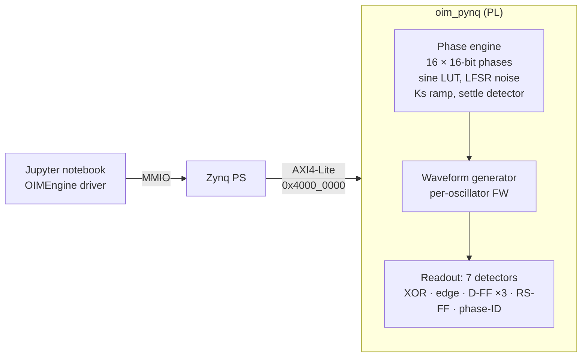

# Ring-Oscillator Ising Machine (OIM) on PYNQ-Z2

An FPGA **digital emulation of a frequency-tunable CMOS ring-oscillator Ising machine** that solves Max-Cut. The design has two parts in the programmable logic (PL) of a Zynq-7020. The first is a phase-dynamics engine for up to 16 coupled oscillators. The second is a readout block that turns phases back into square waves and measures them with seven different hardware detectors. Next to the hardware sits a **bit-exact Python digital twin** (`oim_sim.py`, 55 self-checks). It lets every number the board produces be checked integer-for-integer.

The system modelled is the ring-oscillator Ising machine of **Md. Mizanur Rahaman Nayan and Orchi Hassan, *"Frequency Tunable CMOS Ring Oscillator Based Ising Machine"***. This work is part of my undergraduate thesis at BUET (supervisor: Dr. Orchi Hassan).

| | |
|---|---|
| **Board** | TUL PYNQ-Z2 (`xc7z020clg400-1`) |
| **Toolchain** | Vivado 2024.1, PYNQ, Icarus Verilog 12.0, Python 3 / NumPy / Matplotlib |
| **Custom IP** | `oim_pynq` (AXI4-Lite), base `0x4000_0000`, 4 KB, `C_S00_AXI_ADDR_WIDTH = 10` |
| **Bitstream ID** | `0x4F494D02` ("OIM" + v2 readout) |
| **Fabric clock** | 25 MHz (`FCLK_CLK0`), WNS +3.174 ns |
| **Resources** | 6,014 LUTs, 8 DSP48, 0 BRAM |
| **Max graph size** | `NMAX = 16` oscillators, integer couplings from −8 to +7 |
| **Phase word** | 16-bit unsigned, 2¹⁶ ≡ 2π (0.0055° per LSB) |

---

## 1. Why this project

**Ising machines** are physical systems that settle into the ground state of an Ising Hamiltonian. Many NP-hard problems (Max-Cut, graph colouring, scheduling) can be written in that form. In an **oscillator Ising machine**, each spin is an oscillator and its phase carries the information. Couplings pull pairs of oscillators into or out of phase. A second-harmonic injection lock (**SHIL**) at $2f_0$ pushes each phase toward 0° or 180°, which makes the solution binary.

Building that in silicon is slow and expensive, and many design questions come before the circuit:

- **Coupling and SHIL:** what ratio $K_s/K_c$ actually works, and does it depend on the graph?
- **Readout:** how should phases be read out with simple digital logic, and where does that readout fail?
- **Degenerate solutions:** how do you recover them, and how do you tell a real 90° lock from an oscillator that has jumped to $2f$?

This project answers those questions on an FPGA. The PL provides the speed and determinism of real hardware, and the bit-exact twin means any disagreement between board and model points to a specific register, not a vague "noise" explanation.

I wanted to understand, before anyone builds the chip, which coupling strengths and readout circuits actually work, and an FPGA with a bit-exact software twin is the fastest way to answer that.

---

## 2. Theory

### 2.1 Max-Cut as an Ising problem

For a graph with adjacency matrix $A$ (symmetric, zero diagonal), the couplings are set to $J = -A$ (antiferromagnetic). With spins $s_i \in \lbrace +1, -1 \rbrace$:

```math
H(\mathbf{s}) = -\sum_{i \lt j} J_{ij} s_i s_j
```

```math
\mathrm{cut}(\mathbf{s}) = \frac{1}{4}\sum_{i,j} A_{ij} (1 - s_i s_j) = \frac{|E|}{2} - \frac{H(\mathbf{s})}{2}
```

Minimising $H$ is therefore exactly maximising the cut. The twin checks this identity on every test graph and finds zero error.

### 2.2 Phase dynamics

Each oscillator phase $\phi_i$ evolves as

```math
\frac{d\phi_i}{dt} = \Delta\omega_i - \omega_i \left[ K_c \sum_j J_{ij} \sin(\phi_i - \phi_j) + K_s(t) \sin(2\phi_i) \right] + \sqrt{2D}\, \xi_i(t)
```

where $K_c$ is the coupling strength, $K_s$ the SHIL strength, $\Delta\omega_i$ a per-oscillator detuning (the digital stand-in for the paper's tuning capacitors), $\omega_i$ a per-oscillator gain, and $D$ the noise strength. With $D = 0$ this is the gradient flow of the energy

```math
E(\boldsymbol{\phi}) = -K_c \sum_{i \neq j} J_{ij} \cos(\phi_i - \phi_j) - K_s \sum_i \cos(2\phi_i)
```

so $E$ can only fall. The $\cos 2\phi_i$ term has its minima at 0° and 180°; this is how SHIL turns phases into spins: $\phi = 0° \to +1$ and $\phi = 180° \to -1$.

### 2.3 Locking and frequency tuning

A single detuned oscillator stays locked only while $\lvert \Delta\omega \rvert \lt K_s$. While locked it settles at

```math
\phi^* = \frac{1}{2} \arcsin\left(\frac{\Delta\omega}{K_s}\right)
```

and once unlocked it drifts at rate $\sqrt{\Delta\omega^2 - K_s^2}$. Both formulas are verified in the self-tests. Because of this, the frequency-tuning range is capped at ±0.25, below the default $K_s = 0.30$, so that tuning never unlocks the machine.

### 2.4 Numerical stability

Forward Euler is stable for $\Delta t \lt 2/L$ with $L = K_c d_{\max} + 2K_s$, where $d_{\max}$ is the maximum vertex degree. All runs use a 10× margin (`stable_dt`). Above the limit, the simulation doesn't blow up visibly. Instead it quietly produces a trajectory whose energy is no longer monotone, so the twin checks monotonicity explicitly.

---

## 3. System architecture



### 3.1 Phase engine

- **Update rule:** one Euler step updates all spins in parallel (Jacobi). For spin $i$, it accumulates $\sum_j J_{ij} \mathrm{SIN}(\phi_i - \phi_j)$, adds the SHIL term $\mathrm{SIN}(2\phi_i)$, and applies $K_c$, $K_s$, $\omega_i$, $\Delta\omega_i$ and the time step.
- **Phase wrap for free:** phases are 16-bit unsigned with 2¹⁶ ≡ 2π, so wrapping around 2π needs no logic; the adder simply overflows.
- **Sine:** a 1024-entry signed 16-bit lookup table, indexed by `phase[15:6]`.
- **Noise:** a 32-bit Galois LFSR with feedback mask `0xA3000000` (polynomial x³² + x⁷ + x⁶ + x² + 1). The RTL adds **uniform** noise with variance matched to the Gaussian model. Because the sum over many steps is Gaussian by the central limit theorem, Euler-Maruyama converges to the same SDE.
- **Annealing:** Ks can ramp from `KS_START` to `KS_STOP` by `KS_INC` per step (Q16 fractional increment).
- **Settle detector:** every `STRIDE` steps, the engine compares all phases with the previous snapshot. If the largest change stays below `TOL` for `HOLD` consecutive checks, it raises *settled* and stops. `MAX_STEPS` caps the run.

### 3.2 Readout

After solving, each phase is turned back into a square wave by a numerically controlled oscillator. A frequency word `FW` gives the samples per period: `FW0 = 256` means 256 samples, and `FW = 512` makes that oscillator run at 2f. The waves are then measured against a base oscillator over a `WINDOW` of base periods:

| Detector | What it measures | Strength | Weakness |
|---|---|---|---|
| **XOR + counter** | C = 100 · xor / total; the paper's Algorithm 1 | Simple | Duty-cycle sensitive; reads 50 % for both a 90° lock and a 2f oscillator |
| **Rising-edge counter** | f / f_base | Only detector that sees frequency multiplication | Can't see a slow drift (ratio ≈ 1) |
| **D-FF on base edge** | Spin bit + toggle count | Toggle rate detects loss of lock | One D-FF can false-trip near 0° and 180° under jitter |
| **D-FF on quadrature edge** (base + 90°) | Second toggle count | `min(tog, tog2)`: two D-FFs can't both false-trip | Extra hardware |
| **D-FF on SHIL edge** (2f₀) | 1× oscillator toggles every sample; locked 2f never toggles | Separates 1× from locked 2f on its own | Only meaningful with SHIL reference |
| **RS flip-flop** (SET base, RESET Vᵢ) | Sawtooth D = 100 · (1 − Δφ / 360°) | Duty-immune, since it uses rising edges only; 2× phase range | Blind spot: jumps ~100 % at Δφ = 0 |
| **4-bit phase ID** (Moy et al., *Nature Electronics* 2022) | Thermometer code from taps at 0, 1, 2, 3 × `PHTAP` | Every oscillator latched on the **same** edge, so no measurement skew | Coarse: 8 legal codes, ~45° resolution |

---

## 4. Fixed-point formats

Every quantity has exactly one representation, shared by the RTL, the twin and the driver.

| Quantity | Format | Notes |
|---|---|---|
| Phase | 16-bit unsigned | 2¹⁶ ≡ 2π; 1 LSB = 0.00549° |
| `SIN` LUT | 1024 × signed 16-bit | round(32768 · sin(2πk / 1024)) |
| J (couplings) | signed 4-bit, −8 to +7 | packed 8 per 32-bit word, index 16i + j |
| Kc, Ks, ωᵢ | unsigned Q4.12 | 4096 ≡ 1.0 |
| Δωᵢ | signed Q1.15 | 32768 ≡ 1.0 rad per unit time |
| `DTQ` | unsigned | round((Δt / π) · 2²⁴) |
| `NAMP` | unsigned | √(6 D Δt) · 2¹⁶ / 2π (uniform noise, matched variance) |

**Where `DTQ` comes from.** The real update is Δφ = Δt · r radians, and one radian is 2¹⁶ / 2π LSB. With r stored as r_q / 2¹⁵:

```math
\Delta_{\text{LSB}} = \Delta t \cdot \frac{r_q}{2^{15}} \cdot \frac{2^{16}}{2\pi} = r_q \cdot \frac{\Delta t}{\pi}
\quad\Rightarrow\quad
\Delta_{\text{LSB}} = (\text{DTQ} \cdot r_q) \gg 24
```

---

## 5. Register map

All offsets are bytes from the IP base address. `CTRL` bits 0, 2 and 3 clear themselves.

| Offset | Name | Description |
|---|---|---|
| `0x000` | `CTRL` | `[0]` START, `[1]` soft reset, `[2]` readout start, `[3]` load phases |
| `0x004` | `STATUS` | `[0]` settled, `[1]` engine done, `[3]` readout done |
| `0x008` | `NSPINS` | Number of active oscillators (≤ 16) |
| `0x00C` / `0x010` | `KC` / `KS` | Coupling / fixed SHIL strength (Q4.12) |
| `0x014` | `DTQ` | Time step (see §4) |
| `0x018` | `NAMP` | Noise amplitude |
| `0x01C` | `SEED` | LFSR seed |
| `0x020`–`0x028` | `KS_START`, `KS_STOP`, `KS_INC` | Ks annealing ramp |
| `0x02C` | `MAXSTEPS` | Step budget |
| `0x030`–`0x038` | `TOL`, `STRIDE`, `HOLD` | Settle detector (`HOLD` is 8 bits wide) |
| `0x03C` | `STEPCNT` | Steps executed |
| `0x040` | `DUTY` | Detector duty cycle (16-bit fraction) |
| `0x044` | `WINDOW` | Readout window in base periods |
| `0x048` | `FW0` | Base frequency word (SHIL reference = 2 × `FW0`) |
| `0x04C` | `BASE` | Index of the base oscillator |
| `0x050` | `TOTAL` | Readout tick count |
| `0x054` / `0x06C` / `0x070` | `DFFQ` / `DFF2Q` / `DFFSQ` | Latched D-FF bits (base / quadrature / SHIL edge) |
| `0x058` | `KSCUR` | Current Ks during a ramp |
| `0x05C` | `PHTAP` | Phase-ID tap spacing (default `0x1C71` ≈ 40°) |
| `0x060` | `ID` | `0x4F494D01` (v1) or `0x4F494D02` (v2) |
| `0x080` + 4i | `PHASE[i]` | Phase word read/write |
| `0x0C0` + 4i | `FW[i]` | Per-oscillator frequency word |
| `0x100` + 4i | `W[i]` | Per-oscillator gain ωᵢ |
| `0x140` + 4i | `DW[i]` | Per-oscillator detuning Δωᵢ |
| `0x180` + 4k | `JPACK[k]` | Couplings, 8 × 4-bit per word |
| `0x200` + 4i | `XORC[i]` | XOR counter |
| `0x240` + 4i | `EDGEC[i]` | Rising-edge counter |
| `0x280` + 4i | `TOGC[i]` | Base-edge D-FF toggle counter |
| `0x2C0` + 4i | `PHASEID[i]` | 4-bit phase-ID code |
| `0x300` + 4i | `RSC[i]` | RS-FF high-tick counter |
| `0x340` + 4i | `TOG2C[i]` | Quadrature D-FF toggle counter |
| `0x380` + 4i | `TOGSC[i]` | SHIL-edge D-FF toggle counter |

---

## 6. The Python digital twin (`oim_sim.py`)

One file covers the whole flow, from the continuous model down to a tick-for-tick copy of the readout RTL:

| Stage | Content |
|---|---|
| 0 | Test graphs (size-6, size-5, K₄, a 16-node surrogate, random graphs, King's graph) and the Max-Cut ↔ Ising mapping |
| 1 | Floating-point phase dynamics: the SDE, energy, stability limit, Ks ramps, settling |
| 2 | Waveform emulation, V(t) = (V_DD / 2) · sgn(sin(ωt + φ)) + V_DD / 2, generalised to any duty cycle |
| 3 | Readout: XOR, D-FF, RS-FF and edge counter |
| 4 | The unreadable band of the XOR readout (§8.1) |
| 5 | Degeneracy, 2f frequency multiplication, frequency sweeping |
| 6 | **Bit-exact fixed-point twin of the engine RTL** |
| 7 | The Moy/Kim phase-ID readout and confidence-ranked nearest-neighbour post-processing |
| 8 | **Bit-exact twin of the v2 readout RTL**, all seven detectors |

```bash
python3 oim_sim.py --checks          # 55 self-tests, no plots (fast)
python3 oim_sim.py --all             # every stage, every figure, all checks
python3 oim_sim.py --stage 4         # a single stage
python3 oim_sim.py --all --save      # also write the figures as PNGs
```

All 55 checks pass. They cover the Max-Cut identity, the closed-form detector responses, the unreadable-band widths, locking and drift formulas, the `DTQ` derivation, fixed-point vs float agreement, and the readout twin against its closed forms. The Stage 8 readout twin also matches the v2 RTL on 62 of 62 random test cases.

Useful helpers: `brute_force_maxcut(A)`, `stable_dt(A, Ks)`, `recommend_ks(A)` (centre of the measured Ks window for a known graph), `make_fixed_cfg(...)`, `fixed_run(...)`, `readout_twin(...)`.

---

## 7. Hardware measurement notebook (`oim_pynq.ipynb`)

Every plot in the notebook is **measured on the PL**. The twin is imported only for graph definitions, quantisers, `stable_dt` and the brute-force optimum that hardware results are scored against.

| Section | What it does |
|---|---|
| 1 | `OIMEngine` driver (AXI4-Lite) |
| 2 | **Bit-exactness check:** board phase words vs the twin, integer for integer |
| 3 | Solve the size-6 graph 20 times with noise + Ks annealing; score against the true Max-Cut |
| 4 | The four basic detectors on the size-5 graph with oscillator 2 forced to 2f |
| 4b | All detectors vs phase shift (0–360°), checked against the readout twin counter-for-counter |
| 4c | Duty immunity: XOR vs RS-FF at duty 0.5 and 0.4 |
| 4d | Lock detection: edge counter vs one D-FF vs two D-FFs under detuning |
| 4e | The SHIL-edge D-FF: 1× vs locked 2f |
| 4f | Why frequency must be checked **before** phase |
| 4g | Detector margins on the phases the machine actually produces (40 solves) |
| 5 | The unreadable band, measured on hardware |
| 6 | Degeneracy: XOR vs edge counter; frequency tuning recovers all three K₄ optima |
| 7 / 7b / 7c | Ks/Kc sweep: anneal-then-relax method, the useful window, and how it depends on the graph |
| 8 | The Moy/Kim 4-bit phase-ID readout |

The notebook is committed without cell outputs. Running it on the board regenerates every plot.

---

## 8. Key findings

### 8.1 The unreadable band of the XOR readout

Algorithm 1 sorts the XOR duty C into four classes using a margin M_th:

| Condition | Class |
|---|---|
| C > 100 − M_th | spin −1 (180°) |
| C < M_th | spin +1 (0°) |
| 50 − M_th < C < 50 + M_th | spin 0 (free) |
| anything else | **unreadable** |

With a 50 % duty detector, C = 100 · Δφ / 180° on the rising arm. That puts the unreadable region at four slivers, each (90 − 3.6 · M_th)° wide. At M_th = 20 this gives four 18° slivers, 72° in total, and both the closed form and the measurement agree. The unreadable band disappears exactly at M_th = 25 %, which is the headroom design rule.

### 8.2 The XOR duty cliff and the RS-FF fix

As the detector duty d drops below 50 %, the XOR's anti-phase reading collapses to 200d. Once 200d falls below 100 − M_th, a spin −1 can no longer be read at all. The rising arm stays independent of duty, which is why the problem hides in casual testing. The RS flip-flop uses only rising edges, so its reading at 180° stays at 50.0 % for every duty from 0.30 to 0.50.

### 8.3 Degeneracy: 90° lock vs 2f

The paper notes that a 90° lock and an oscillator running at 2f both read C ≈ 50 % on the XOR. The rising-edge counter separates them (ratio 1.005 vs 2.010). On the size-5 graph, this recovers the readout `S = [+1, 0, -1, -1, +1]`. Oscillator 2 is identified as frequency-multiplied, and the free vertex expands into both optimal partitions the paper reports.

### 8.4 The Ks/Kc window is measured, not assumed

The useful window is the range of Ks/Kc where P(optimum) ≥ 0.95 **and** the fraction of phases within 5° of 0° or 180° is also ≥ 0.95. The second condition matters because the readout needs binary phases. Results for the size-6 graph, using the fixed-point RTL model (40 runs per point):

| Ks/Kc | 0.000 | 0.025 | 0.050 … 0.450 | 0.475 | 0.500 | 0.600 |
|---|---|---|---|---|---|---|
| P(opt) | 0.925 | 1.000 | 1.000 | 0.775 | 0.650 | 0.425 |
| binarised | 0.417 | 0.921 | 1.000 | 0.850 | 0.767 | 0.813 |

The window is **0.05 to 0.45**, wider than the 0.1 to 0.4 quoted earlier on both sides. The default Ks = 0.30 sits inside it. However, **the window depends on the graph** (float model, 200 runs per point):

| Graph | size-6 | K₄ | size-5 | random-10 | surrogate-16 | King 3×4 |
|---|---|---|---|---|---|---|
| Window | 0.05–0.45 | 0.05–0.80 | 0.45–0.80 | 0.60–0.70 | 0.50–0.80 | none |

On frustrated graphs, a weak Ks produces fixed points that genuinely aren't binary: the cut still rounds to the optimum, but the readout is left with unresolved spins. One fixed Ks can't serve every graph. The remedies are `recommend_ks(A)`, or ramping Ks up past the binarisation edge.

### 8.5 Fixed base oscillator vs neighbour post-processing

Algorithm 1 compares every oscillator to one base oscillator. On a high-diameter graph with spatially varying drift, the Moy/Kim scheme does better: it resolves spins from the most confident nearest-neighbour edges first. On that test it reached a normalised cut of 1.000, against 0.921 for Algorithm 1.

---

## 9. Design and verification flow

1. **Float model:** SDE, energy, stability, locking; checked against closed forms.
2. **Fixed-point twin:** pick formats (§4), derive `DTQ` and `NAMP`, and confirm the fixed-point model recovers the same spins and cut as the float model.
3. **RTL:** write `oim_pynq.v` (engine + readout) to match the twin integer for integer. It was verified bit-exact against the twin in simulation, by running the same vectors through Icarus Verilog.
4. **IP packaging and block design:** AXI4-Lite IP, Zynq PS, AXI interconnect, reset, 25 MHz fabric clock.
5. **Board bring-up:** notebook section 2 compares board phase words with the twin. Since the RTL is already proven bit-exact, any mismatch means a wrong register value, not a wrong design.
6. **Measurement:** notebook sections 3–8.

### Implementation results (Vivado 2024.1)

| Metric | Value |
|---|---|
| Fabric clock | 25 MHz |
| Worst negative slack (WNS) | +3.174 ns |
| LUTs | 6,014 |
| DSP48 | 8 |
| Block RAM | 0 |

The design does not close timing at 100 MHz, so the fabric clock is set to 25 MHz. The reset block keeps its default name `rst_ps7_0_100M` from the original 100 MHz block design; only the clock was changed.

---

## 10. Bugs, pitfalls and lessons

### Model and algorithm

**Ks chosen outside the window.** An earlier version used Ks = 0.6 everywhere. That's outside the useful window, and it measurably hurt: P(opt) was 0.60 fixed and 0.96 ramped, instead of 1.00. *Fix:* measure the window and use Ks = 0.30. *Lesson:* a parameter that "works" isn't necessarily the right one, so sweep it.

**One default Ks for every graph.** `KS_DEFAULT` was derived on the size-6 graph, and hardware data showed it falls outside the window for size-5, random-10 and surrogate-16. Cuts still came out right, but phases didn't binarise, so the readout left spins unresolved. *Fix:* `recommend_ks(A)`, a warning in `make_fixed_cfg` when Ks is outside that graph's window, and the Ks ramp.

**LFSR draw ordering between twin and RTL.** The RTL reads `lfsr_q` in the SHIL cycle and only then advances the LFSR, so the first spin of the first step sees the seed itself. If the twin advances first, it runs one draw ahead of the hardware for every noisy run, and bit-exactness breaks. *Fix:* the twin's `next()` returns the current state, then advances.

**Silent Euler instability.** Above Δt = 2/L the simulation doesn't diverge loudly; energy simply stops falling monotonically. *Fix:* `stable_dt` with a 10× margin, plus an explicit monotonicity check.

**Phase readings for oscillators that have no phase.** A 2f oscillator has no phase relative to the base, yet every phase detector still returns a number for it: the XOR gives a flat 50 %, and the RS-FF gives plausible-looking values. *Fix:* the readout pipeline checks frequency first.

**Duty quantisation.** With `FW = 256`, the duty cycle is quantised to 1/256. A requested 0.45 is really 116/256, so the XOR peak reads 2 × 116/256 = 90.63 %, not 90.00 %. *Lesson:* compare hardware against the quantised value, not the requested one.

**The XOR readout hides its duty problem.** Its rising arm is duty-independent, so tests near 0° look perfect while the anti-phase reading has already collapsed. *Fix:* sweep the full 0–360° range and add the RS-FF.

### RTL and board bring-up

**Toggle counters counted a toggle that never happened.** The first sample of each sampling clock was compared against the priming value, so every lane started with one false toggle. *Fix:* the first edge of each sampling clock only arms the counter; a toggle is counted only between two real samples.

**`$readmemh` failed silently in Vivado.** The sine LUT loaded as all zeros when the project path contained spaces. *Fix:* keep the project in a path with no spaces.

**AXI base address was not where the driver expected.** Vivado 2024.1 auto-assigned `0x4000_0000`, not the commonly quoted `0x43C0_0000`. *Fix:* read the address from the `.hwh` (PYNQ does this through `ol.ip_dict`) instead of hard-coding it.

**Wrong top module in the bitstream.** With several modules in the project, Vivado picked the wrong top. *Fix:* set the top module explicitly before running synthesis.

**Timing failure at 100 MHz.** The phase engine's accumulate path does not meet 100 MHz. *Fix:* run the fabric at 25 MHz, which closes with +3.174 ns of slack.

**LFSR comment didn't match the RTL.** A comment listed the taps as 32, 22, 2, 1, but the feedback mask `0xA3000000` implements x³² + x⁷ + x⁶ + x² + 1. The twin follows the RTL, so results were unaffected, but the documentation was wrong. *Lesson:* derive documentation from the code, not from comments.

---

## 11. Repository structure

```
oim-pynq/
├── README.md
├── .gitattributes            # marks .hwh as generated
└── pynq_files/
    ├── mainDesign.bit        # bitstream (v2 readout, ID 0x4F494D02)
    ├── mainDesign.hwh        # hardware handoff
    ├── oim_pynq.ipynb        # hardware measurement notebook
    └── oim_sim.py            # digital twin + 55 self-checks
```

## 12. Running it

**On the PYNQ-Z2:**
1. Copy everything in `pynq_files/` into one folder on the board, e.g. `/home/xilinx/jupyter_notebooks/oim/`. The notebook imports `oim_sim`, so it must sit in the same folder.
2. Open `oim_pynq.ipynb` in Jupyter and run the sections in order. Don't skip section 2.

**Without a board:** the twin runs on any machine with Python 3, NumPy and Matplotlib:

```bash
python3 oim_sim.py --checks
```

Notebook section 4d mentions `oim_pipeline.py` for the jitter study; that file isn't in this repository yet.

---

## 13. Limitations and future work

- **Up to 16 oscillators**, with integer couplings from −8 to +7. That's enough for small Max-Cut instances and weighted graphs with small integer weights, but not for large benchmarks.
- **25 MHz fabric clock.** Pipelining the accumulate path would let the engine run faster.
- **No jitter source in the PL readout.** The D-FF jitter study lives in software; adding an LFSR-driven edge jitter would let the board test it directly.
- **Fixed graphs per run.** Couplings are loaded over AXI-Lite, so batch solving many instances is limited by the CPU. A BRAM or DMA path would speed up sweeps.
- **Next steps:** larger N with time-multiplexed oscillators, sparse King's-graph coupling to match Moy et al., and the confidence-ranked neighbour post-processing done in hardware.

## 14. References

1. M. M. R. Nayan and O. Hassan, *"Frequency Tunable CMOS Ring Oscillator Based Ising Machine."*
2. W. Moy, I. Ahmed, P. Chiu, J. Moy, S. S. Sapatnekar and C. H. Kim, *"A 1,968-node coupled ring oscillator circuit for combinatorial optimization problem solving,"* Nature Electronics **5**, 310–317 (2022).

## Author

**Jarif Shahriar Ahmed** ([@archnoid98](https://github.com/archnoid98)), EEE, Bangladesh University of Engineering and Technology (BUET)
